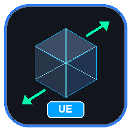

# FBX Unreal Rescaler

<p align="center">
  
  <br>
  <strong>A standalone desktop application for permanent scale baking and normalization of rigged skeletal meshes and animations for Unreal Engine (1 unit = 1 cm).</strong>
</p>

<p align="center">
  
  
  
  
  
</p>

---

## Overview

Importing character models and animations into Unreal Engine from external 3D software (Blender, Maya, 3ds Max, Mixamo) frequently leads to unit scale discrepancies (e.g., 1 unit = 1 meter, character heights of 1.8 units instead of 180 cm, or non-uniform scaling artifacts). Adjusting "Import Uniform Scale" inside Unreal Engine often corrupts socket attachments, cloth physics, ragdoll constraints, and root motion calculations.

**FBX Unreal Rescaler** solves this by performing low-level binary matrix transformations using the **Autodesk FBX Python SDK**:
- **Bakes physical dimensions** directly into Control Points (Vertices) and Bone Translations.
- **Supports Non-Uniform Scaling**: Preserves distinct axis ratios (e.g. elongated props, squashed geometry) without collapsing shapes into uniform spheres.
- **Freezes node scaling** to absolute `(1.0, 1.0, 1.0)` across the entire scene hierarchy (Root, Armature Empty, Meshes, Bones).
- **Recalculates skinning Bind Poses** (`FbxCluster` TransformMatrix & TransformLinkMatrix, plus `FbxPose`) to prevent skeletal distortion or mesh explosion.
- **Bakes translation animation curves** while leaving rotations and unit scales intact.
- **Enforces Unreal Engine units**: Converts scene metadata to Centimeters (`FbxSystemUnit.cm`) and coordinates to Z-Up while blocking automatic SDK geometric double-scaling.

---

## Key Features

1. **Intuitive Drag-and-Drop Batch Processing**:
   - Drag and drop single files, multiple FBX files, or entire folders into the drop zone.
2. **Dynamic Scaling Modes**:
   - **Auto-Normalize (180 cm Standard)**: Automatically reads the character's visual bounding box, determines height along the up-axis, and scales the asset to human proportions (180 cm).
   - **Manual Multiplier**: Custom float spin box (`0.001` - `1000.0` with 3-decimal precision) for precision override (e.g., `0.010`, `1.000`, `100.000`).
3. **Custom Export Destination**:
   - Easily choose a custom output folder for exported files or leave empty to save adjacent to the original file with `_UE_Scaled.fbx` suffix.
4. **Blender Armature Dummy Filter**:
   - Strictly ignores dummy Empty objects (such as `Armature` parent `FbxNull` nodes) and only modifies pure `FbxSkeleton` bones.
5. **C++ RAII Memory Management**:
   - Explicit `FbxManager.Destroy()` destruction in clean Python context managers to prevent memory leaks during large batch operations.
6. **Live Multi-Colored Console Log**:
   - Real-time status reporting with color-coded alerts (Cyan for Info, Green for Success, Orange for Warnings, Red for Errors).

---

## Project Structure

```
fbx-unreal-rescaler/
│
├── assets/
│   ├── icon.ico                   # Multi-resolution application icon
│   └── icon.png                   # High-resolution logo
│
├── src/
│   ├── main.py                    # Application entry point with High-DPI support
│   │
│   ├── core/                      # FBX SDK Core Engine
│   │   ├── fbx_context.py         # RAII memory manager for FbxManager
│   │   ├── scale_calculator.py    # World visual bounding box & scale analysis
│   │   ├── geometry_scaler.py     # Per-axis vertex & blend shape baking
│   │   ├── skeleton_scaler.py     # Bone translation baking & absolute scale reset
│   │   ├── bindpose_scaler.py     # FbxCluster & FbxPose matrix recalculation
│   │   ├── anim_scaler.py         # Translation animation curve scaling
│   │   └── rescaler_pipeline.py   # Complete 5-step Bake & Reset pipeline
│   │
│   └── ui/                        # PyQt6 User Interface
│       ├── main_window.py         # Main window integration
│       ├── drop_zone.py           # Drag & Drop zone widget
│       ├── scale_config.py        # Mode selection, spin box & export directory
│       ├── console_view.py        # Live dark console view widget
│       └── worker_thread.py       # Asynchronous background batch worker
│
├── tests/
│   └── test_scale_math.py         # Automated unit tests
│
├── requirements.txt               # Python package dependencies
├── pyinstaller.spec               # PyInstaller standalone build configuration
├── run_app.bat                    # One-click Windows launcher
├── run_silent.vbs                 # Silent background launcher (no CMD window)
└── README.md
```

---

## Installation & Setup

### Prerequisites
- Python 3.10+ (Recommended: Conda / Miniconda 64-bit environment).
- Windows 10/11 64-bit.

### 1. Clone the Repository
```bash
git clone https://github.com/your-username/fbx-unreal-rescaler.git
cd fbx-unreal-rescaler
```

### 2. Install Python Dependencies
```bash
pip install -r requirements.txt
```

### 3. Autodesk FBX Python SDK Setup
> [!IMPORTANT]
> **Autodesk FBX Python SDK Bindings:**
> The official FBX SDK bindings are **not** distributed on PyPI (do not use `pip install fbx`).
> Place the pre-compiled binary files:
> - `fbx.pyd` (or `fbx.cp310-win_amd64.pyd`)
> - `FbxCommon.py`
>
> directly in the repository root directory or inside your Python environment's `site-packages`.

---

## Running the Application

### Option A: From Terminal
```bash
python src/main.py
```

### Option B: Without Terminal (One-Click)
- Double-click **`run_app.bat`** in the project folder.
- Or double-click **`run_silent.vbs`** to launch silently without any command prompt window.

---

## Running Unit Tests

To run the automated mathematical and logic test suite:
```bash
python -m unittest tests/test_scale_math.py
```

---

## Building Standalone Executable (.exe)

Compile into a standalone Windows `.exe` using PyInstaller:
```bash
pyinstaller pyinstaller.spec
```
The compiled executable will be located at:
`dist/FBX_Unreal_Rescaler/FBX_Unreal_Rescaler.exe`

---

## License

This project is licensed under the MIT License - see the LICENSE file for details.
